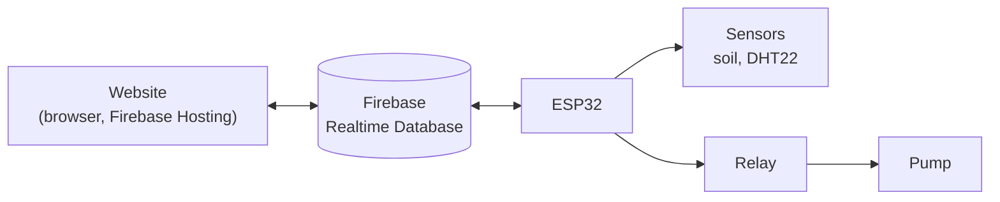
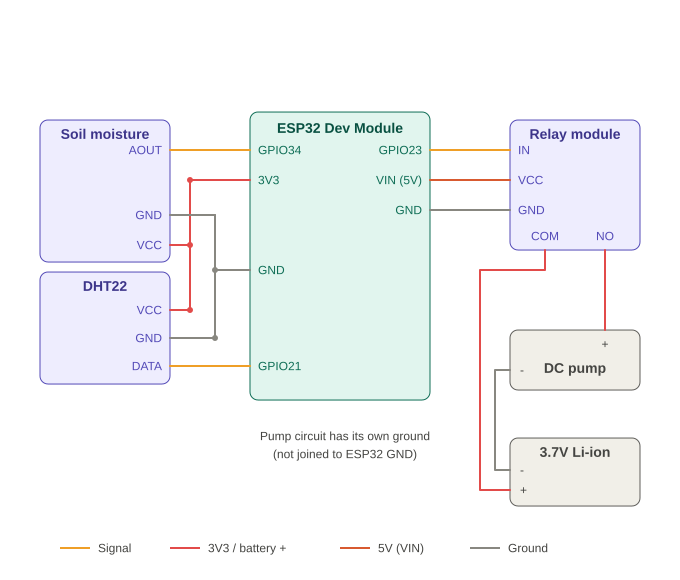
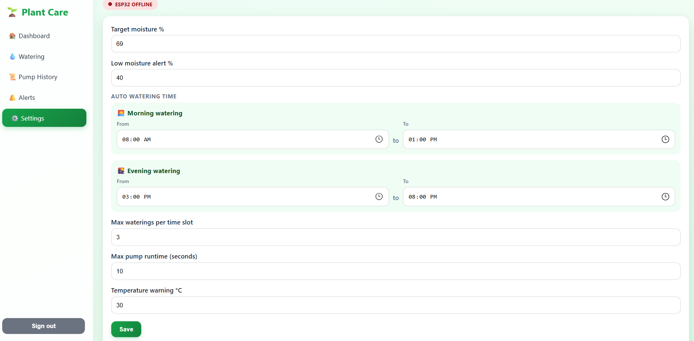
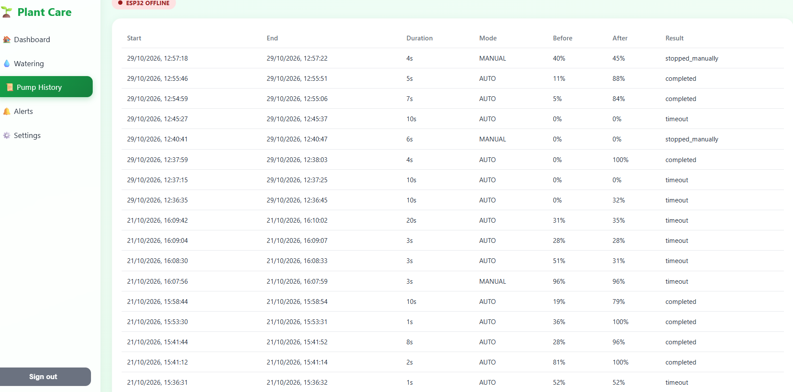

# 🌱 Smart Plant Care

An IoT-based **Money Plant monitoring and automatic watering system** built with an **ESP32**, **Firebase Realtime Database** and a responsive web dashboard.

The ESP32 reads soil moisture, temperature and humidity, controls a water pump through a relay, and syncs live with a website that can be opened from any phone or PC.

**Live demo:** https://smart-plant-care-2966d.web.app (login required)


---

## Features

- Live **soil moisture**, **temperature** and **humidity** with a real-time chart
- **AUTO mode:** waters only inside configurable time windows (morning and evening), with a maximum number of waterings per window, so the plant is not watered in the midday heat
- **MANUAL mode:** start and stop the pump from the website
- **Safety rules enforced on the ESP32** (not on the website):
  - Pump stops at the target moisture in AUTO mode
  - Maximum pump runtime
  - Sensor error shutdown
  - Shutdown if the Firebase connection is lost
- Requested command and confirmed pump state are shown separately
- **Pump history:** start/stop time, duration, mode, moisture before/after, result
- **Alerts** for low soil moisture, temperature, sensor errors and timeouts
- **Money Plant care advice:** ideal ranges, status badges, tips and popup alerts
- Countdown to the next allowed AUTO watering
- Secure login with Firebase Authentication and database security rules

---

## System architecture



The website and the ESP32 never talk directly. Both read and write the same Firebase paths. Pump safety logic runs locally on the ESP32.

---

## Hardware

| Component | Details |
|---|---|
| Microcontroller | ESP32 Dev Module (ESP32D) |
| Soil moisture sensor | Capacitive soil moisture sensor |
| Temperature and humidity | DHT22 |
| Relay | 1-channel relay module (active LOW) |
| Pump | Small DC water pump |
| Power | 3.7 V Li-ion battery for the pump, USB for the ESP32 |

### Wiring diagram



| Part | ESP32 pin |
|---|---|
| Soil sensor AOUT | GPIO34 |
| Soil sensor VCC / GND | 3V3 / GND |
| DHT22 DATA | GPIO21 |
| DHT22 VCC / GND | 3V3 / GND |
| Relay IN | GPIO23 |
| Relay VCC / GND | VIN (5V) / GND |

Pump circuit: battery **+** → relay **COM**, relay **NO** → pump **+**, pump **-** → battery **-**. The pump circuit is separate from the ESP32 ground.

> Note: the relay module used here did not switch off reliably with a 3.3 V HIGH signal, so the firmware turns the relay off by releasing the pin (open-drain). Check your own module if you use a different one.

---

## Project structure

```
smart-plant-care/
├── README.md
├── .gitignore
├── website/
│   ├── index.html
│   ├── style.css
│   ├── firebase.json
│   └── js/
│       ├── app.js
│       └── firebase-config.js
├── firmware/
│   ├── sketch_oct17a.ino
│   └── secrets.example.h
└── images/
    ├── wiring.svg
    ├── dashboard.png
    ├── settings.png
    ├── history.png
    └── hardware.jpg
```

---

## Firebase database structure

```
authorized/{uid}: true
plant/
  sensors/        soilMoisture, temperature, humidity, lastUpdated, sensorOk
  control/        mode, pumpCommand, targetMoisture, lowMoistureThreshold,
                  maxPumpRuntimeSeconds, tempWarning,
                  window1Start, window1End, window2Start, window2End,
                  maxWaterPerWindow, rev
  status/         pumpOn, lastSeen, lastWatering, ackRev, nextAutoTs,
                  slot, slotCount, slotMax
  history/{id}    startTs, endTs, durationSec, mode, moistureBefore,
                  moistureAfter, result
  notifications/{id}  ts, type, message
```

### Security rules

```json
{
  "rules": {
    "authorized": { ".read": false, ".write": false },
    "plant": {
      ".read":  "auth != null && root.child('authorized').child(auth.uid).val() === true",
      ".write": "auth != null && root.child('authorized').child(auth.uid).val() === true"
    }
  }
}
```

Only users listed under `authorized` can read or write. The database is not public.

---

## Setup guide

### 1. Firebase

1. Create a project at https://console.firebase.google.com
2. **Authentication → Email/Password → Enable.** Create two users: one for you (website) and one for the ESP32.
3. **Realtime Database → Create database** (locked mode).
4. Add both user UIDs under `authorized` with the value `true`.
5. Publish the security rules above.
6. **Project settings → Your apps → Web app**, then copy the config into `website/js/firebase-config.js`.

### 2. Website

Run locally with VS Code Live Server, or deploy with Firebase Hosting from inside the `website` folder:

```
npm install -g firebase-tools
firebase login
firebase init hosting
firebase deploy --only hosting
```

Use `.` as the public directory.

### 3. ESP32 firmware

1. Install the **ESP32 board package** in Arduino IDE.
2. Install the libraries **Firebase Arduino Client Library for ESP8266 and ESP32** (Mobizt), **DHT sensor library** and **Adafruit Unified Sensor**.
3. Copy `firmware/secrets.example.h` to `firmware/secrets.h` and fill in your values:

```cpp
#define WIFI_SSID     "YOUR_WIFI_NAME"
#define WIFI_PASS     "YOUR_WIFI_PASSWORD"
#define API_KEY       "YOUR_FIREBASE_WEB_API_KEY"
#define ESP_PASSWORD  "YOUR_ESP32_USER_PASSWORD"
```

4. Calibrate the soil sensor: read the raw value in dry air (`AIR_VALUE`) and in water (`WATER_VALUE`) and set them in the code.
5. In Arduino IDE choose **Tools → Board → ESP32 Dev Module** and **Tools → Partition Scheme → Huge APP**.
6. Upload.

`secrets.h` is listed in `.gitignore` and must never be committed.

---

## How it works

1. The user presses **Start pump** on the website, which writes `plant/control/pumpCommand = "ON"`.
2. The ESP32 polls `plant/control` about every second and starts the pump if the safety conditions allow it.
3. The ESP32 writes the confirmed state to `plant/status/pumpOn`.
4. The website updates automatically through a Firebase listener.

In AUTO mode the ESP32 checks the current time (NTP, Bangladesh time UTC+6). Inside a watering window, if moisture is below the start threshold, the window count is not used up and the minimum gap has passed, it runs the pump until the target moisture or the maximum runtime is reached.

---

## Money Plant ideal ranges

| Sensor | Ideal | Alert |
|---|---|---|
| Soil moisture | 40–70 % | below the low-moisture setting, or above 85 % |
| Temperature | 18–30 °C | below 15 °C or above 32 °C |
| Humidity | 40–60 % | below 35 % or above 75 % |

These are general guidelines and the sensor values are approximate.

---

## Screenshots

| Dashboard | Settings |
|---|---|
|  |  |

| Pump history | Hardware setup |
|---|---|
|  |  |

---

## Safety and limitations

- Safety-critical pump control runs on the ESP32. The website only sends requests.
- The pump will not run without internet (AUTO needs NTP time and Firebase settings, and the pump stops if Firebase is unreachable for 30 seconds).
- Browser popup alerts work only while the page is open. Background push notifications would need Firebase Cloud Messaging, which is not included.
- Soil moisture percentage depends on sensor calibration.
- In MANUAL mode the pump runs until stopped or until the maximum runtime ends.
- This project was tested on the author's own hardware setup only.

---

## Author

**M A Nabihan Tasin**
Student ID: 0432320005101182 | Section: 7C
Course:Internet Of Thinks
University: University of Information Technology and Sciences 

## License

[MIT License or "For academic use only"]
